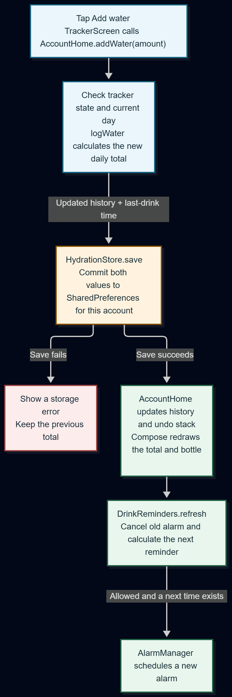
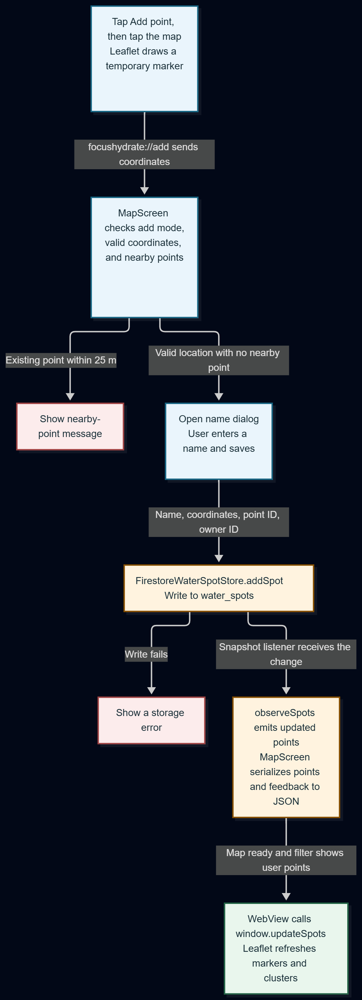

# FocusHydrate

FocusHydrate is an Android app that helps students log water intake and remember to drink during study sessions. It is a course project for Mobile Systems.

- **Tracker** logs water in one tap, with a default portion of 250 ml and an adjustable daily goal.
- **Statistics** show intake in a calendar and charts for the last 7, 30 or 365 days, or the full history.
- **Refill map** lets users add shared refill points and leave feedback. It uses Leaflet, OpenStreetMap tiles and Cloud Firestore. Searching for tap-water quality by city is outside the M2 scope.
- **Settings** let users manage their account, switch between Polish and English, and schedule Android drinking reminders by day, time and interval.

## Run the app

1. Open the [project](project/) folder in Android Studio.
2. Install Android SDK Platform 37 and sync the Gradle project using Android Studio's bundled JDK.
3. Run the **app** configuration on an emulator or phone running Android 7.0 (API 24) or newer.

From the repository root on Windows, with the Android SDK and JDK configured:

```powershell
.\project\gradlew.bat -p project :app:assembleDebug
.\project\gradlew.bat -p project :app:testDebugUnitTest :app:lintDebug
.\project\gradlew.bat -p project :app:connectedDebugAndroidTest --no-configuration-cache
```

The last command requires a running emulator or a connected phone.

## M2 demo checklist

- **Core flow.** Start online, register with fictional details and add 250 ml in Tracker. Check that the daily total increases.
- **Persistence.** Close and reopen the app, then check the saved total in Tracker and the entry in Statistics.
- **Network and fallback.** While online, open the map and add a clearly named test refill point. Turn off Wi-Fi and mobile data while the app is open, then try adding another point. Check the offline message and return to Tracker to log water. Reconnect and retry the map operation.
- **Mobile capability.** Enable reminders in Settings and allow Android notifications. Use **Send test notification** to show system delivery. Logging water resets the scheduled reminder interval. Deny or disable notifications in Android settings, then check the permission message in the app and confirm you can still log water.

## Data and offline use

Intake history, daily goals, reminder settings and the signed-in account ID are stored on the device. Account records, shared refill points and feedback use Cloud Firestore. OpenStreetMap supplies the map background.

Tracker and Statistics read local data once the account is open. Use an internet connection for first launch and registration. Reopening the app offline depends on cached account data. The map may display cached tiles or points, and adding points or posting feedback requires a connection.

The optional coloured areas are labelled as fictional demo data. Use them to demonstrate filtering and use verified local information for decisions about drinking water.

## Architecture

### Add water

Logging water updates the account's daily history in SharedPreferences. Compose refreshes the Tracker, and Android's AlarmManager updates the reminder schedule.



[Mermaid source](docs/add-water.mmd)

### Add a refill point

Adding a refill point sends the selected coordinates from Leaflet to the Android screen. A Firestore write saves the point, and a snapshot listener refreshes the map markers.



[Mermaid source](docs/add-refill-point.mmd)

## Team

- Antoni Usajewicz (257292)
- Fabian Rudnicki (257289)
- Mateusz Jurek (262701)
